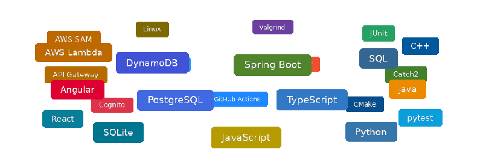

# Hi, I'm Nicholas Sobchak

**Computer science student at UMBC · Graduating May 2027**

### C++ systems · Backend development · Cloud infrastructure

I build native engines, backend APIs, and the web applications around them.

---
  

